# Secure Web Application on Azure

A web app on a hardened Linux VM, with a database that cannot be reached from the internet.

Originally a university project, rebuilt and documented here.

---

## What was built

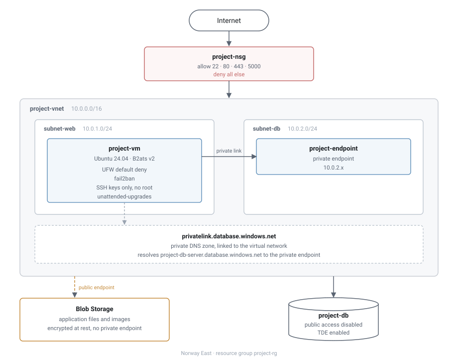

- One resource group, `project-rg`, in Norway East.
- Virtual network, `10.0.0.0/16`, split into two subnets.
- `subnet-web` - VM and web app.
- `subnet-db` - private endpoint for the database.
- Ubuntu 24.04, Standard B2ats v2, 2 vCPU, 1 GiB.
- Azure SQL Database, Blob Storage, private DNS zone.

Web tier takes traffic from strangers, data tier never does.

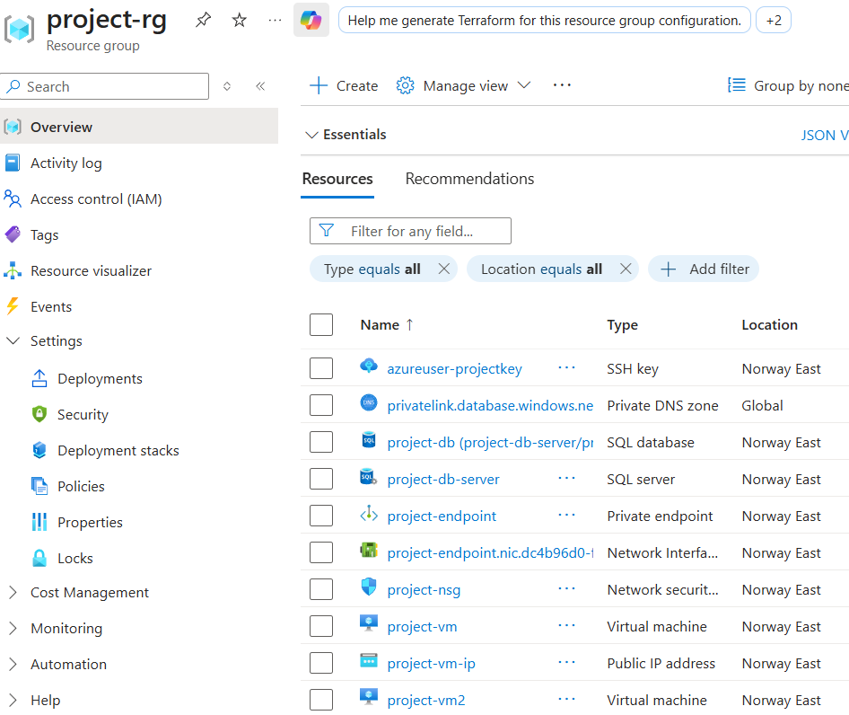

---

## Network

- Network security group allows 22, 80, 443 and 5000.
- All other traffic hits the default deny rule.

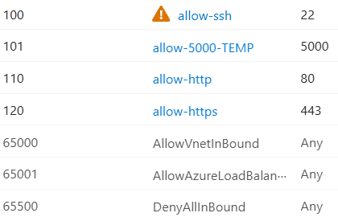

Tested from outside Azure:

- `Test-NetConnection` to port 1234 failed.
- Ping timed out.

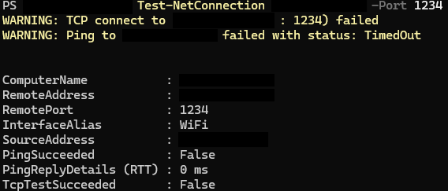

---

## Host

- UFW active, default deny on incoming.
- SSH keys only. No password login, & no root.
- `AllowGroups` blocks root, the account exists but cannot log in.
- fail2ban: **49** failed attempts, **5** addresses banned.
- unattended-upgrades running.

A second firewall behind the first. The NSG is a portal setting and one wrong click opens a port.

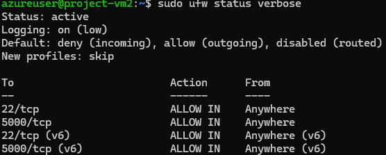
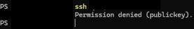
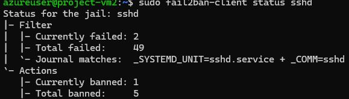

---

## Data

- Public access to the database **disabled**.
- **0** firewall rules; nothing to allow.
- Only route in is a private endpoint in `subnet-db`.
- A private DNS zone points the public hostname at the private address.
- Encryption at rest on.

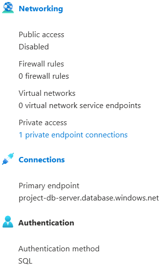
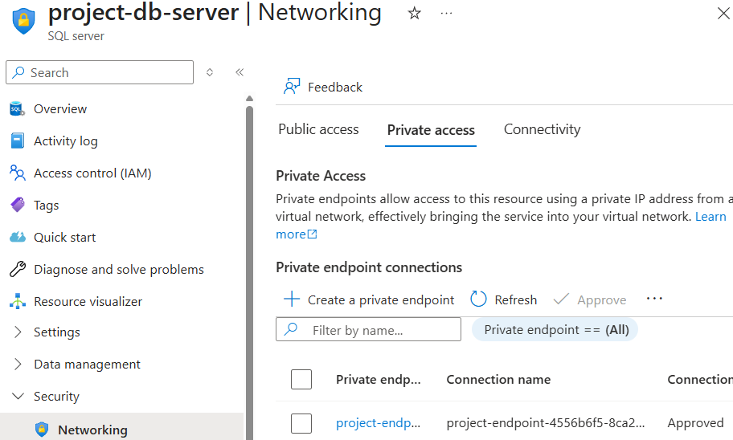

Blob Storage is encrypted at rest, but has no private endpoint.

---

## What it found

Scanners found the server, none of this is simulated.

- Login attempts for `admin`, `library`, `root`, `auto`, `cf1c22`.
- UFW dropped port 80 and 443 scans from **10** separate addresses.
- App served create, read and delete requests.

Nobody got in, the accounts tried either do not exist or are not permitted to log in.

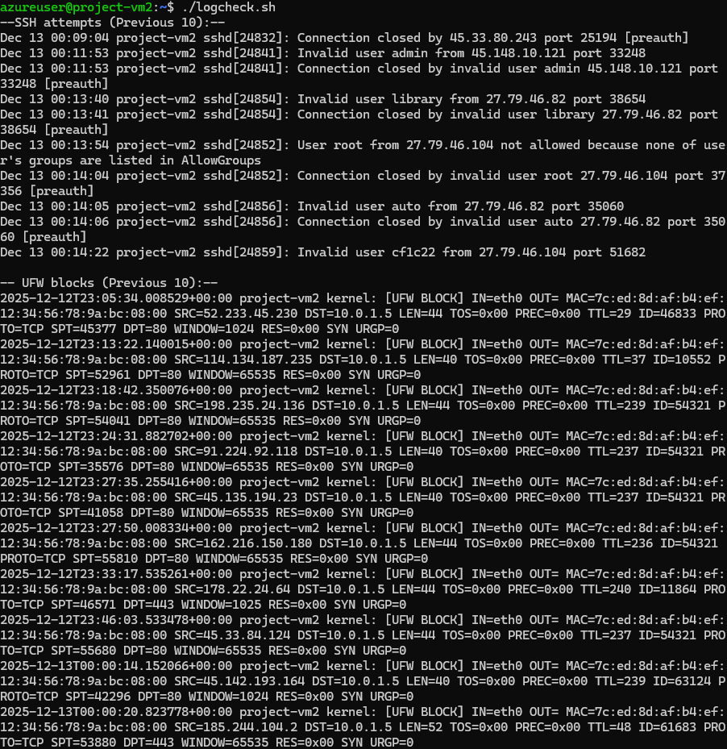
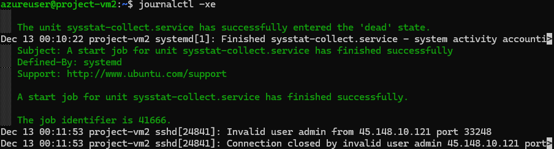

---

## Operations

- `backup_web.sh` archives the app directory, filename dated.
- cron runs it nightly at 02:00.
- Logs rotate weekly, four weeks kept.

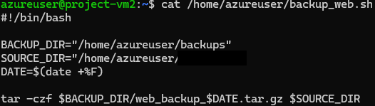
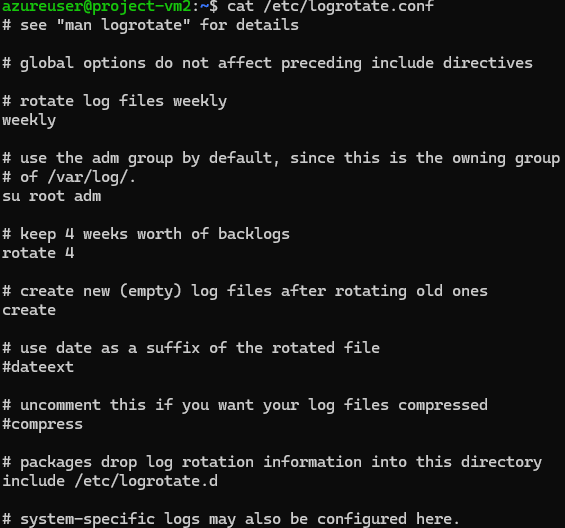

---

## Changes I wish to make

- Port 5000 left open. Rule is named `allow-5000-TEMP` and shipped anyway. Open at the NSG and at UFW.
- SSH is open, Azure flags it in the portal. A jump host is the fix, fail2ban only limits damage.
- Blob Storage has no private endpoint while the database does.
- Role-based access never set up. Entra ID was not available on the subscription.
- Access matrix gave developers Contributor plus database owner. Enough to delete the database and the VM.
- Encryption at rest was an Azure default, not something I configured.

---

## Scaling it

One VM does not scale. There is no load balancer, and files are on a local disk, so a second VM would not see them.

The shape of the design will not change, only the  compute underneath.

- **Small** - this, as it is.
- **Growing** - App Service or a scale set, files to Blob Storage, web application firewall in front.
- **Large** - more than one region, scaling on traffic, access split by team, private endpoints on everything.

---

## License

MIT. See `LICENSE`.
